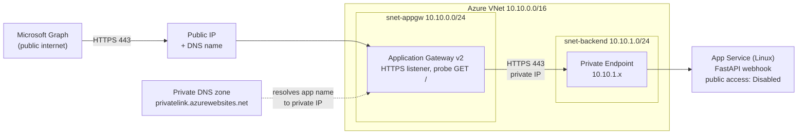

# graph-webhook

A deliberately tiny FastAPI app that receives **Microsoft Graph change notifications** (for example "a user was added to / removed from a Teams channel"), plus the documentation for hosting it **privately inside an Azure VNet behind Application Gateway**.

> **Status:** the app has been run and tested locally. **Nothing has been deployed to Azure**, and the Azure CLI commands in this README have **not been executed**. Treat them as a starting point and check flags with `az <command> --help` before running them.

**This is an unauthenticated R&D endpoint.** It trusts every request. See [section 6](#6-before-this-becomes-production) before using it for anything real.

---

## Contents

1. [What this app does](#1-what-this-app-does)
2. [Prerequisites](#2-prerequisites)
3. [Local development setup](#3-local-development-setup)
4. [Testing locally](#4-testing-locally)
5. [Microsoft Graph webhook notes](#5-microsoft-graph-webhook-notes)
6. [Before this becomes production](#6-before-this-becomes-production)
7. [Azure architecture](#7-azure-architecture)
8. [Azure deployment guide](#8-azure-deployment-guide)
9. [Troubleshooting](#9-troubleshooting)
10. [Design decisions](#10-design-decisions)

---

## 1. What this app does

| Route | Purpose | Response |
|---|---|---|
| `GET /` | Health check. Logs `Hello World`. Application Gateway's health probe targets this. | `200` `{"message": "Hello World"}` |
| `POST /webhook?validationToken=...` | Graph's subscription handshake. | `200`, `Content-Type: text/plain`, body = the token |
| `POST /webhook` (JSON body) | A real change notification. The full payload is logged. | `202 Accepted`, empty body |

Everything else is out of scope on purpose: no Graph authentication, no subscription creation or renewal, no database, no queue.

Project layout:

```text
graph-webhook/
├── app/
│   ├── __init__.py      # empty; makes "app" a Python package
│   └── main.py          # the whole application
├── .env.example         # optional settings (LOG_LEVEL)
├── .gitignore
├── pyproject.toml       # project metadata + dependencies (managed by uv)
├── uv.lock              # exact pinned versions (commit this)
└── README.md
```

There is no `requirements.txt` on purpose. Azure App Service builds directly from `pyproject.toml` + `uv.lock` (see [section 10](#10-design-decisions)).

---

## 2. Prerequisites

| Tool | Why | Check |
|---|---|---|
| **Python 3.12+** | Runtime (`requires-python = ">=3.12"`). uv can also download Python for you. | `python3 --version` |
| **uv** | Creates the virtual environment, installs packages, runs the app. [Install guide](https://docs.astral.sh/uv/getting-started/installation/). | `uv --version` |
| **Azure account** | Needed only for deployment. | portal.azure.com |
| **Azure CLI** | Needed only for deployment. [Install guide](https://learn.microsoft.com/cli/azure/install-azure-cli). | `az --version` |
| **curl** | Testing. | `curl --version` |

---

## 3. Local development setup

### Option A: use this repository as-is

```bash
cd graph-webhook
uv sync                                   # create .venv and install exactly what uv.lock says
uv run uvicorn app.main:app --reload      # start the server on http://127.0.0.1:8000
```

### Option B: rebuild the project from scratch

Every command, in order:

```bash
mkdir graph-webhook && cd graph-webhook

uv init --bare --python 3.12
```
Creates a minimal `pyproject.toml` only (no sample `main.py`, no README). `--python 3.12` sets `requires-python = ">=3.12"`, a version Azure App Service supports.

```bash
uv add fastapi uvicorn
```
Adds both packages to `pyproject.toml`, creates `.venv/` automatically, installs them, and writes `uv.lock`.

```bash
mkdir app
touch app/__init__.py
# now create app/main.py (copy it from this repo)
```
`__init__.py` makes `app` an importable package, so `app.main:app` means "the variable `app` inside `app/main.py`".

```bash
uv run uvicorn app.main:app --reload
```
`uv run` executes a command inside the project's virtual environment (creating or updating it first if needed). `uvicorn` is the web server, `app.main:app` is where it finds the FastAPI object, and `--reload` restarts on code changes (development only).

### Optional: `.env` settings

```bash
cp .env.example .env
uv run --env-file .env uvicorn app.main:app --reload
```

The only setting is `LOG_LEVEL` (default `INFO`). `.env` is git-ignored.

---

## 4. Testing locally

Start the server in one terminal, then use a second terminal.

### Health check

```bash
curl -i http://localhost:8000/
```

Expected response:

```text
HTTP/1.1 200 OK
content-type: application/json

{"message":"Hello World"}
```

Expected log line: `... | INFO | graph-webhook | Hello World`

### Webhook validation handshake

```bash
curl -i -X POST "http://localhost:8000/webhook?validationToken=test123"
```

Expected response (note: **plain text**, not JSON):

```text
HTTP/1.1 200 OK
content-type: text/plain; charset=utf-8

test123
```

Expected log line: `... | INFO | graph-webhook | Received validation request`

Real tokens from Graph contain spaces and punctuation, sent URL-encoded. The app returns the decoded text, which is what Graph requires:

```bash
curl -i -X POST "http://localhost:8000/webhook?validationToken=Validation%3A%20Testing%20client%20application%20reachability"
# body: Validation: Testing client application reachability
```

### Change notification

```bash
curl -i -X POST http://localhost:8000/webhook \
  -H "Content-Type: application/json" \
  -d '{
    "value": [
      {
        "subscriptionId": "test-subscription",
        "changeType": "created",
        "resource": "teams/test-team/channels/test-channel/members/test-user",
        "clientState": "test-state"
      }
    ]
  }'
```

Expected response: `HTTP/1.1 202 Accepted` with an empty body.

Expected log lines (one notification in this example; the payload is logged on a single line so it is easy to search in Azure):

```text
2026-10-30 09:46:42,164 | INFO | graph-webhook | Received 1 notification(s)
2026-10-30 09:46:42,164 | INFO | graph-webhook | Payload: {"value": [{"subscriptionId": "test-subscription", "changeType": "created", "resource": "teams/test-team/channels/test-channel/members/test-user", "clientState": "test-state"}]}
```

Graph can batch several notifications into one request. The app counts and logs the whole `value` array, so a body with two items logs `Received 2 notification(s)`.

### Bad input (extra behavior)

A non-JSON body on `/webhook` returns `400` and logs a warning. Without this, a stray request would crash with a 500 and Graph would treat the endpoint as failing.

### About the log format

Application logs use `timestamp | level | logger name | message` and go to **stdout**, which Azure App Service captures. Uvicorn's own `INFO: 127.0.0.1 - "POST /webhook ..."` access lines have a different format and no timestamp. That is normal.

---

## 5. Microsoft Graph webhook notes

1. **Graph must reach your URL from the public internet.** The webhook URL you give Graph is the Application Gateway's public HTTPS address, for example `https://webhook.example.com/webhook`.
2. **The certificate must be publicly trusted** and match the host name. Graph will not accept a self-signed certificate.
3. **The backend stays private.** Only Application Gateway has a public IP.
4. **Application Gateway forwards both `GET` and `POST`** by default. Your health probe uses `GET /`; Graph uses `POST /webhook`.
5. **Validation handshake:** when you create a subscription, Graph sends `POST /webhook?validationToken=...` and expects `200`, `text/plain`, and the decoded token as the body, within **10 seconds**. If it fails, the subscription is not created.
6. **Real notifications:** reply with `202` (or any `2xx`) within **3 seconds**. Slow or failing endpoints are retried with backoff and can be marked "slow" or "drop", which delays or discards notifications. This is why `/webhook` does no work beyond logging, and why you should keep the backend warm (the deployment guide enables Always On in Step 4).
7. **Subscription expiry and renewal are yours to manage.** This app does none of it.

Sources: [Receive change notifications through webhooks](https://learn.microsoft.com/graph/change-notifications-delivery-webhooks).

---

## 6. Before this becomes production

This endpoint accepts anything from anyone who finds the URL. A production webhook should at least:

- **Check `clientState`.** You choose a secret `clientState` when creating the subscription, and Graph echoes it in every notification. Compare each item in `value` with your stored secret (use a constant-time comparison) and discard mismatches. Keep the secret in App Service settings or Key Vault, not in code.
- **Consider `validationTokens` and JWT verification.** Notifications that carry encrypted resource data, and lifecycle notifications, can include a `validationTokens` array of JWTs. Validate the signature against Microsoft's published signing keys, plus the issuer and audience, before trusting the payload. Check the current [Graph documentation](https://learn.microsoft.com/graph/change-notifications-delivery-webhooks) for which of your subscription types include them.
- **Respond fast, process later.** Move real work to a queue or background worker so you stay inside the 3-second limit.
- **Handle lifecycle notifications** (`reauthorizationRequired`, `missed`, `subscriptionRemoved`) and renew subscriptions before they expire.
- **Add authentication-adjacent hardening** such as a WAF on Application Gateway and request size limits.

---

## 7. Azure architecture

### Key point: a VNet does not make an app private

Putting an app "in a VNet" is ambiguous in Azure, and it usually only affects **outbound** traffic:

| Feature | Direction | Effect |
|---|---|---|
| App Service **VNet integration** | Outbound | The app can reach private resources. The app is **still publicly reachable**. |
| App Service **Private Endpoint** | **Inbound** | Gives the app a private IP in your VNet so private clients can call it. Combined with "public network access: Disabled", the app has no public entry point. |
| Container Apps **internal environment** | Inbound + outbound | The environment's load balancer gets a private IP in your VNet. No public ingress. |

You need an inbound-private feature, not just VNet membership.

### Comparing the two options

| | **App Service + Private Endpoint** | **Container Apps (internal environment)** |
|---|---|---|
| Deploy artifact | Zip of the source; Azure builds it. uv is supported (see below). | A container image, so you need a `Dockerfile` and a registry. |
| Private inbound mechanism | Private endpoint (NIC with a private IP in your subnet) and private DNS zone `privatelink.azurewebsites.net` | Internal environment on a delegated subnet (minimum `/27`, cannot be resized later) and a private DNS zone for the environment's default domain with `*` and `@` A records |
| Subnet use | The backend subnet only holds the private endpoint NIC. | The subnet must be dedicated to the Container Apps environment. |
| Application Gateway backend | App's `*.azurewebsites.net` name, host name picked from backend | App's FQDN, host name picked from backend |
| Minimum paid tier | Basic plan (private endpoints are supported on Basic and above) | Workload-profiles environment, plus registry |
| Gotchas | Disabling public access also blocks deployment from the internet (deploy first, or deploy from inside the VNet). | Scale-to-zero would add cold-start latency against Graph's 3-second limit, so set min replicas to 1. |

**Recommendation: App Service + Private Endpoint.** For a two-endpoint Python app it is the simpler path: no Dockerfile, no registry, no delegated environment subnet, and App Service's Python build supports `pyproject.toml` + `uv.lock` natively ([App Service Python docs](https://learn.microsoft.com/azure/app-service/configure-language-python)). Container Apps with internal ingress is also technically suitable, and the Application Gateway pattern is documented ([Container Apps + Application Gateway](https://learn.microsoft.com/azure/container-apps/waf-app-gateway)). Choose it if you want to experiment with containers.

### Diagram



### How the pieces talk

1. Graph calls `https://webhook.example.com/webhook`. DNS points at the gateway's **public IP**.
2. Application Gateway terminates TLS, then opens a **new connection** to its backend.
3. The backend pool contains the app's name, `<app>.azurewebsites.net`. Inside the VNet, the linked **private DNS zone** resolves that name to the **private endpoint's IP** (10.10.1.x). Outside the VNet, the same name resolves to the app's public IP, which is blocked.
4. Traffic flows from the gateway subnet to the private endpoint over the VNet's private address space. It never leaves Azure's network.
5. Because public network access is disabled, calling `https://<app>.azurewebsites.net` directly from the internet fails (typically `403`). Application Gateway is the only way in.

### Network security groups

- **Gateway subnet (`snet-appgw`)**: an NSG must allow inbound `443` (and `80` if you use it) from the internet, inbound **`GatewayManager` on `65200-65535`** (Application Gateway v2 management; blocking it breaks the gateway), and the default `AzureLoadBalancer` allow must stay. Do not block outbound internet. Do not add a route table that forces `0.0.0.0/0` through an appliance. Microsoft recommends a `/24` subnet for v2 and no other resource types in it ([infrastructure configuration](https://learn.microsoft.com/azure/application-gateway/configuration-infrastructure)).
- **Backend subnet (`snet-backend`)**: holds only the private endpoint. NSGs are not enforced on private endpoints unless you enable private endpoint network policies on the subnet. Not needed for this experiment.

---

## 8. Azure deployment guide

Legend used below:

- 🟢 **CLI**: copy-paste runnable in bash (after replacing placeholders).
- 🔵 **Portal**: do this by hand in the Azure Portal, or skip it if you prefer the CLI equivalent noted.

The order is chosen so you can test at each stage and **deploy the code before you lock the app down**.

### Step 0: variables and login 🟢

```bash
az login
az account set --subscription "<your-subscription-name-or-id>"

RG=rg-graph-webhook
LOC=southeastasia                      # pick a region near you
VNET=vnet-graph-webhook
PLAN=plan-graph-webhook
APP=graphwebhook-<unique-suffix>       # globally unique -> https://<APP>.azurewebsites.net
DOMAIN=webhook.example.com             # a domain you control (needed for the public TLS cert)
```

### Step 1: resource group, VNet and subnets 🟢

```bash
az group create -n $RG -l $LOC

az network vnet create -g $RG -n $VNET -l $LOC \
  --address-prefixes 10.10.0.0/16 \
  --subnet-name snet-appgw --subnet-prefixes 10.10.0.0/24

az network vnet subnet create -g $RG --vnet-name $VNET \
  -n snet-backend --address-prefixes 10.10.1.0/24
```

- `snet-appgw` is **dedicated** to Application Gateway. Nothing else can live there.
- `snet-backend` will hold the app's private endpoint.

### Step 2: network security group for the gateway subnet 🟢

```bash
az network nsg create -g $RG -n nsg-appgw -l $LOC

az network nsg rule create -g $RG --nsg-name nsg-appgw -n AllowHttpsInbound \
  --priority 100 --direction Inbound --access Allow --protocol Tcp \
  --source-address-prefixes Internet --destination-port-ranges 443

az network nsg rule create -g $RG --nsg-name nsg-appgw -n AllowGatewayManager \
  --priority 110 --direction Inbound --access Allow --protocol Tcp \
  --source-address-prefixes GatewayManager --destination-port-ranges 65200-65535

az network vnet subnet update -g $RG --vnet-name $VNET -n snet-appgw \
  --network-security-group nsg-appgw
```

### Step 3: (optional sanity check) test the code before any Azure work 🟢

```bash
uv run uvicorn app.main:app
# in another terminal: curl commands from section 4
```

### Step 4: create the App Service plan and web app 🟢

Private endpoints need at least the **Basic** tier, so use `B1`.

```bash
az appservice plan create -g $RG -n $PLAN -l $LOC --is-linux --sku B1

az webapp list-runtimes --os linux | grep -i python     # pick a value >= 3.12

az webapp create -g $RG -p $PLAN -n $APP --runtime "PYTHON:3.12"
```

Configure the build and start command:

```bash
# Build dependencies during zip deployment (Oryx uses pyproject.toml + uv.lock)
az webapp config appsettings set -g $RG -n $APP --settings \
  SCM_DO_BUILD_DURING_DEPLOYMENT=1 LOG_LEVEL=INFO

# Start uvicorn on port 8000, listening on all interfaces
az webapp config set -g $RG -n $APP \
  --startup-file "python -m uvicorn app.main:app --host 0.0.0.0 --port 8000"

# Keep the app loaded so Graph's 3-second limit isn't blown by cold starts
az webapp config set -g $RG -n $APP --always-on true
```

> **Verify on first deploy:** the Python docs describe the uv build, but do not show a FastAPI startup command. If the app doesn't start, check `az webapp log tail` (Step 5). If the platform can't find the port, add `--settings WEBSITES_PORT=8000`. If the uv build misbehaves, use the fallback in [section 10](#10-design-decisions).

### Step 5: deploy the code and test it (public access still on) 🟢

```bash
# Package only what's needed (no .venv)
zip -r app.zip app pyproject.toml uv.lock -x "*/__pycache__/*"

az webapp deploy -g $RG -n $APP --src-path app.zip --type zip

# Turn on log capture, then stream logs in a second terminal
az webapp log config -g $RG -n $APP --application-logging filesystem --level information
az webapp log tail -g $RG -n $APP

curl -i https://$APP.azurewebsites.net/
curl -i -X POST "https://$APP.azurewebsites.net/webhook?validationToken=abc123"
```

You should see `200` with `Hello World`, then `200 text/plain` with `abc123`. Do this **before** step 6, because after the lock-down you cannot deploy from your laptop.

### Step 6: private endpoint and private DNS 🟢

```bash
APP_ID=$(az webapp show -g $RG -n $APP --query id -o tsv)

# 6a. Private endpoint in the backend subnet
az network private-endpoint create -g $RG -n pe-$APP -l $LOC \
  --vnet-name $VNET --subnet snet-backend \
  --private-connection-resource-id $APP_ID \
  --group-id sites --connection-name conn-$APP

# 6b. Private DNS zone, linked to the VNet
az network private-dns zone create -g $RG -n privatelink.azurewebsites.net

az network private-dns link vnet create -g $RG \
  -z privatelink.azurewebsites.net -n link-$VNET \
  --virtual-network $VNET --registration-enabled false

# 6c. Auto-create the A records (main site and the SCM/Kudu site)
az network private-endpoint dns-zone-group create -g $RG \
  --endpoint-name pe-$APP -n default \
  --private-dns-zone privatelink.azurewebsites.net --zone-name azurewebsites
```

Check the record: `az network private-dns record-set a list -g $RG -z privatelink.azurewebsites.net -o table` should list `<APP>` with a `10.10.1.x` address.

### Step 7: disable public access to the app 🟢

```bash
az resource update -g $RG -n $APP --resource-type "Microsoft.Web/sites" \
  --set properties.publicNetworkAccess=Disabled
```

After this, `curl https://$APP.azurewebsites.net/` from the internet should fail (typically `403`). **Disabling public access also affects the SCM (Kudu) site**, so future deployments must come from inside the VNet (for example a self-hosted CI runner or jump box), or you must temporarily re-enable public access.

### Step 8: DNS name and TLS certificate 🔵 (portal / your DNS provider)

Graph requires an HTTPS URL with a **publicly trusted certificate** matching the host name.

1. Pick a domain you control, such as `webhook.example.com`.
2. Obtain a certificate from a public CA (a Let's Encrypt cert works; Azure Key Vault can hold or issue them) and export it as a `.pfx` file with a password.
3. After Step 9, create an **A record** `webhook.example.com` pointing to the gateway's public IP.

(A self-signed certificate is fine for your own curl tests with `-k`, but Graph will reject it.)

### Step 9: Application Gateway 🟢

```bash
# 9a. Public IP (Standard SKU, static, required for v2)
az network public-ip create -g $RG -n pip-appgw -l $LOC \
  --sku Standard --allocation-method Static

# 9b. Gateway: v2, one instance, backend = the app's default host name over HTTPS
az network application-gateway create -g $RG -n agw-graph-webhook -l $LOC \
  --sku Standard_v2 --capacity 1 --priority 100 \
  --vnet-name $VNET --subnet snet-appgw \
  --public-ip-address pip-appgw \
  --frontend-port 80 \
  --servers $APP.azurewebsites.net \
  --http-settings-protocol Https --http-settings-port 443
```

> Application Gateway v2 is billed by the hour while it exists, and is likely the most expensive part of this setup. Delete the resource group when you are done experimenting (`az group delete -n $RG`).

Now configure the pieces the design calls for:

```bash
# 9c. Health probe: GET / over HTTPS, host name taken from the backend
az network application-gateway probe create -g $RG --gateway-name agw-graph-webhook \
  -n probe-root --protocol Https --path / \
  --host-name-from-http-settings true \
  --interval 30 --timeout 30 --threshold 3 --match-status-codes 200-399

# 9d. Backend HTTP settings: HTTPS 443, use the probe, send the app's own host name
az network application-gateway http-settings update -g $RG --gateway-name agw-graph-webhook \
  -n appGatewayBackendHttpSettings \
  --protocol Https --port 443 \
  --host-name-from-backend-pool true --probe probe-root

# 9e. HTTPS frontend: certificate, port 443, listener
az network application-gateway ssl-cert create -g $RG --gateway-name agw-graph-webhook \
  -n cert-webhook --cert-file ./webhook.pfx --cert-password '<pfx-password>'

az network application-gateway frontend-port create -g $RG --gateway-name agw-graph-webhook \
  -n port-443 --port 443

az network application-gateway http-listener create -g $RG --gateway-name agw-graph-webhook \
  -n listener-https --frontend-port port-443 \
  --frontend-ip appGatewayFrontendIP --ssl-cert cert-webhook \
  --host-name $DOMAIN

# 9f. Routing rule: HTTPS listener -> backend pool + settings
az network application-gateway rule create -g $RG --gateway-name agw-graph-webhook \
  -n rule-https --rule-type Basic --priority 200 \
  --http-listener listener-https \
  --address-pool appGatewayBackendPool \
  --http-settings appGatewayBackendHttpSettings
```

What each part does:

| Setting | Value | Why |
|---|---|---|
| Public frontend IP | `pip-appgw` | The only public entry point. |
| HTTPS listener | port 443, your PFX certificate, host name `webhook.example.com` | Graph connects here. |
| Backend pool | `<APP>.azurewebsites.net` | Resolves to the private endpoint inside the VNet. |
| Backend HTTP settings | HTTPS 443, "pick host name from backend target" | App Service routes by host name and its default certificate is for `*.azurewebsites.net`. |
| Health probe | `GET /`, host from backend settings, `200-399` | The app's health endpoint. |
| Routing rule | listener -> pool + settings | Forwards both `GET` and `POST`. |

Because the default listener from step 9b is on port 80, you can remove or leave the port-80 listener and rule (`rule1`, `appGatewayHttpListener`). Leaving it exposes plain HTTP to the same backend. Delete it if you only want HTTPS.

> **DNS caching:** Application Gateway caches DNS results. If you created or linked the private DNS zone after the backend pool, restart the gateway once: `az network application-gateway stop -g $RG -n agw-graph-webhook` then `az network application-gateway start -g $RG -n agw-graph-webhook`.

Point your DNS at it:

```bash
az network public-ip show -g $RG -n pip-appgw --query ipAddress -o tsv
# create an A record: $DOMAIN -> that IP, at your DNS provider
```

### Step 10: check backend health and test the public endpoint 🟢

```bash
az network application-gateway show-backend-health -g $RG -n agw-graph-webhook \
  --query "backendAddressPools[].backendHttpSettingsCollection[].servers[].health" -o tsv
# expect: Healthy

curl -i https://$DOMAIN/
curl -i -X POST "https://$DOMAIN/webhook?validationToken=abc123"
curl -i -X POST https://$DOMAIN/webhook -H "Content-Type: application/json" \
  -d '{"value":[{"subscriptionId":"s","changeType":"created","resource":"r","clientState":"c"}]}'
```

Expected: `200 Hello World`; `200` `text/plain` `abc123`; `202 Accepted`. The payload log line should appear in your logs (see Step 11).

Finally, give Graph this notification URL when you create your subscription: `https://webhook.example.com/webhook`.

### Step 11: read logs after the lock-down 🟢

`az webapp log tail` (and the Portal's Log stream) go through the app's SCM/Kudu site, which is private after Step 7, so they may stop working from outside the VNet. Send the console output to Log Analytics instead; this is configured through the Azure management plane, so it works regardless:

```bash
az monitor log-analytics workspace create -g $RG -n law-graph-webhook -l $LOC
WS_ID=$(az monitor log-analytics workspace show -g $RG -n law-graph-webhook --query id -o tsv)

az monitor diagnostic-settings create --name diag-console \
  --resource $APP_ID --workspace $WS_ID \
  --logs '[{"category":"AppServiceConsoleLogs","enabled":true}]'
```

Then query in the Portal (Log Analytics workspace, Logs). Logs can take a few minutes to appear:

```kusto
AppServiceConsoleLogs
| where ResultDescription contains "Payload"
| order by TimeGenerated desc
```

### Cleanup 🟢

```bash
az group delete -n $RG --yes --no-wait
```

---

## 9. Troubleshooting

| Symptom | Likely causes and fixes |
|---|---|
| **Application Gateway returns 502 Bad Gateway** | The gateway can't get a valid response from the backend. Run `show-backend-health` (step 10) for the reason. Usual causes: backend name doesn't resolve to the private IP (DNS zone not linked to the VNet, or gateway cached an old result: stop/start it); backend HTTP settings use HTTP but the app expects HTTPS (or the reverse); host name not overridden, so App Service rejects the `Host` header; the app crashed on startup. |
| **Health probe failing / backend "Unhealthy"** | Probe must use **HTTPS**, path `/`, and "pick host name from HTTP settings". Confirm `GET /` works from inside the VNet. Check match codes (`200-399`). Check the app started (Log Analytics, or `az webapp log tail` if public access is still on). A custom startup command that fails makes App Service fall back to default behavior, so verify the startup command. |
| **Backend unreachable** | Check the private endpoint's connection state is `Approved`; the DNS zone group created the A record; the zone is linked to **the same VNet** as the gateway; the app isn't stopped. Private endpoints serve inbound only, so there is no firewall rule on the app to open. |
| **Incorrect subnet configuration** | The gateway subnet must contain only Application Gateways, and v1 and v2 must not share it. A `/24` is recommended. Its NSG must allow `GatewayManager` on `65200-65535` and `AzureLoadBalancer`. Don't block outbound internet, and don't force-tunnel `0.0.0.0/0` through an appliance. If the gateway shows as failed or management operations hang, check these first. |
| **HTTPS certificate problems** | Graph rejects self-signed, expired, wrong-host-name, or incomplete-chain certificates. Use a publicly trusted cert for the exact name you give Graph, include intermediates in the PFX, and make sure the A record points to the gateway's IP. Test with `curl -v https://$DOMAIN/` (no `-k`). Backend certificate errors are different: they come from the HTTP settings, and the default `*.azurewebsites.net` certificate only matches when the host name is overridden. |
| **Graph validation fails ("subscription not created")** | The endpoint must reply `200` with `text/plain` and the **decoded token as the body**, within 10 seconds. Verify with `curl -i -X POST "https://$DOMAIN/webhook?validationToken=abc123"`. Common causes: gateway routes only `GET`; a redirect from HTTP to HTTPS (Graph doesn't follow it, so give it the HTTPS URL); the backend returning JSON; or the gateway returning 502/504. |
| **Graph reports timeouts or notifications are delayed** | Graph expects a response within **3 seconds** for real notifications. Enable Always On, avoid cold starts, keep the handler to logging only, check backend latency, and watch for `slow`/`drop` throttling when many requests exceed 3 seconds. |
| **Can't deploy after disabling public access** | Expected: SCM/Kudu is private too. Re-enable public access temporarily (`publicNetworkAccess=Enabled`), deploy, then disable again, or deploy from a machine inside the VNet. |
| **`curl` to the `*.azurewebsites.net` name works from the internet after step 7** | Public network access isn't actually disabled. Re-check the app property: `az webapp show -g $RG -n $APP --query publicNetworkAccess`. |

---

## 10. Design decisions

- **Two routes, one file.** The goal is to learn webhooks and Azure networking, not framework structure.
- **`request.json()` instead of a Pydantic model for the body.** Graph payloads vary by resource and subscription type, and the validation request has no body at all, so a required body model would reject it with `422`. Parsing manually keeps both cases on one route.
- **`validationToken` is returned as FastAPI/Starlette decodes it.** The query string is URL-decoded once, which is what Graph requires. Do not decode it again.
- **FastAPI's `/docs`, `/redoc` and `/openapi.json` are disabled.** They would otherwise be reachable through the public gateway, and you asked for only two endpoints. To re-enable them for local exploration, remove the `docs_url=None, redoc_url=None, openapi_url=None` arguments in `app/main.py`.
- **Invalid JSON returns `400`.** Not in the original spec, but a 500 from a malformed request would make the endpoint look unhealthy.
- **No `requirements.txt`.** App Service's Python build picks `requirements.txt` first if it exists (pip), then `pyproject.toml` + `uv.lock` (uv). Shipping both would silently bypass `uv.lock`. If the uv build doesn't work for you, generate a fallback and redeploy:

  ```bash
  uv export --no-dev --no-hashes -o requirements.txt
  ```

- **`uvicorn` directly, not Gunicorn.** App Service's docs show Gunicorn for WSGI apps and the default startup command is Gunicorn. For one small ASGI app, plain uvicorn avoids an extra dependency. If you later want multiple worker processes, add `gunicorn` and start with `gunicorn -k uvicorn.workers.UvicornWorker app.main:app`.
- **Logging to stdout.** App Service captures container stdout, so no log files or handlers are needed.
